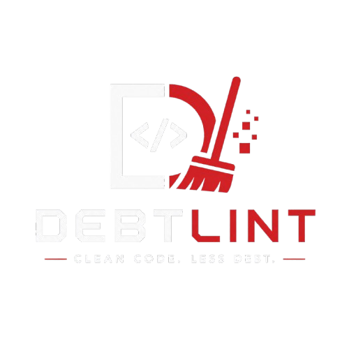

# Debtlint

**Debtlint** finds duplicated and near-duplicate code across a codebase.
It is built for the era of AI code generation: fast, language-agnostic, and easy to plug into local workflows, CI, and agents.

## Install

```bash
cargo install debtlint
```

From this repository:

```bash
cargo install --path .
```

## Quick start

No config file required. From any project root:

```bash
debtlint
```

That is the full happy path: install, then run.

Useful variants:

```bash
debtlint src                      # analyze a subdirectory
debtlint --report-format json     # JSON for CI / agents
```

On first run, Debtlint trains a BPE vocabulary and writes `.debtlint/debtlint.vocab.json` (and creates `.debtlint/debtlint.config.json` with defaults if missing). Later runs reuse the cache automatically.

## Demo

Try the bundled corpus (three copy-pasted Python helpers):

```bash
debtlint examples --vocab-size 250
```

Expected excerpt:

```
Debtlint report
───────────────
  groups:      3
  occurrences: 9
  files:       1

#1 3 copies · … tokens · up to … chars
  duplicated_code.py:4-32
  duplicated_code.py:32-60
  duplicated_code.py:60-85
  preview duplicated_code.py:4-32
   4 │ def process_user_001(name, age, country, newsletter):
   5 │     username = name.strip().lower()
   ...
```

You should see **3 groups** (user / price / email), each with **3 copies**.  
`--vocab-size 250` keeps BPE from over-compressing this small file. Details: [examples/README.md](./examples/README.md).

## When the vocabulary cache refreshes

Debtlint reuses `.debtlint/debtlint.vocab.json` when it is still compatible. It retrains when:

- the cache file is missing,
- you pass `--vocab-size` or `--save-vocab` (force retrain),
- format / algorithm versions differ,
- the file count at least **doubled** and grew by **≥ 100** files,
- the majority language changed, or its share shifted by **more than 50** percentage points.

Treat the vocab file as an opaque cache; do not edit it by hand.

## Configuration (optional)

Built-in defaults apply if `.debtlint/debtlint.config.json` is absent. Override only when you need a custom scan root or excludes.

- `dir`: scan root (overridden by the CLI `DIR` argument).
- `excludes`: directory names (`target`) and globs (`*.json`). **Replaces** the built-in list (no merge).

### Default excludes (summary)

Skipped by default: build dirs (`target`, `node_modules`, `dist`, …), tool caches, Debtlint’s own `.debtlint/`, plus globs such as `*.json`, `*.yaml`, `*.md`, `*.txt`, images, lockfiles, minified assets, and common binaries.

Full list: [doc/excludes.md](./doc/excludes.md).

### Override example

If your code lives in `.txt` files, remove `*.txt` from excludes (copy the defaults, drop that glob):

```json
{
  "dir": ".",
  "excludes": ["target", "node_modules", "dist", "build", ".debtlint", "*.json", "*.md"]
}
```

> Same idea for `*.md` if you want Markdown scanned. Setting a short `excludes` list drops every other default glob — see [doc/excludes.md](./doc/excludes.md) for a full copy-paste list without `*.txt`.

A legacy `debtlint.config.json` at the repo root is still accepted and migrated into `.debtlint/` on first run.

## How it works

1. **Ingestion** walk the tree (Git-independent), respect `.gitignore` and `excludes`. Symlinks are not followed.
2. **BPE encoding** train or reuse a vocabulary that surfaces recurring token patterns.
3. **Winnowing** fingerprint shingles and extend matches into duplicated blocks.
4. **Report** human-readable text by default, or JSON (`--report-format json`).

More detail: [doc/bpe.md](./doc/bpe.md) · [doc/hyperparams.md](./doc/hyperparams.md) · [doc/excludes.md](./doc/excludes.md)

## CLI

```bash
debtlint [DIR] [OPTIONS]
```

| Flag | Default | Description |
|------|---------|-------------|
| `DIR` | config / `.` | Directory to analyze (overrides `dir` in config) |
| `--vocab-size <N>` | `1000` | Max vocabulary size; forces retrain when set |
| `--min-frequency` | `2` | Min pair frequency to create a merge |
| `--load-vocab <PATH>` | — | Load a vocabulary JSON and skip cache/training |
| `--save-vocab <PATH>` | — | Force retrain; also write a legacy export to PATH |
| `--output-encoded <PATH>` | — | Write encoded token sequences as JSON |
| `--shingle-size` | `50` | Shingle size in tokens (Winnowing) |
| `--window-size` | `3` | Sliding window size in shingles |
| `--min-tokens` | `20` | Minimum duplicated block length in tokens |
| `--report-format` | `text` | `text` or `json` |

```bash
debtlint
debtlint src
debtlint --report-format json
debtlint --vocab-size 2000          # force retrain with a larger vocab
```

## GitHub Actions

Use the action in this repository (`action.yml` at the root).
See [action/README.md](./action/README.md) for inputs and details.

```yaml
name: Check duplication

on:
  pull_request:
    branches: [main]

jobs:
  debtlint:
    runs-on: ubuntu-latest
    permissions:
      contents: read
      pull-requests: write

    steps:
      - uses: actions/checkout@v4

      - name: Run debtlint
        uses: PoCInnovation/Debtlint@v1
```

`vocab-path` is optional. Omit it to let Debtlint train/cache normally; set it only to force `--load-vocab`.

## Agent integration

Prefer the **skill + CLI in the agent sandbox** (not MCP):

1. generate or edit code,
2. run `debtlint --report-format json`,
3. refactor reported duplicates,
4. re-run until clean (or after a few iterations).

Skill: [`skills/debtlint`](./skills/debtlint).

## Vision

As coding assistants become mainstream, silent duplication appears quickly: utilities get rewritten, patterns repeat, logic fragments across files. Debtlint gives a programmatic, fast, and cheap way to catch that drift early.

## License

This project is licensed under the [Apache License 2.0](./LICENSE).

## Contributing

Contributions are welcome.
Read the guide: [CONTRIBUTING.md](./CONTRIBUTING.md)

[Project presentation video](https://www.youtube.com/watch?v=-JjcPTZ7Omg&feature=youtu.be)

## Our PoC team ❤️

Developers

|  [Enzo Ruffino](https://github.com/EnzoRuffino) |  [Loan Riyanto](https://github.com/skl1017) |  [Rayan](https://github.com/Rayan-ouer) |
| :--------------------------------------------------------------------------------------------: | :------------------------------------------------------------------------------------: | :-----------------------------------------------------------------------------------: |

Manager

|  [Laurent Gonzalez](https://github.com/lg-epitech) |  [Lohan](https://github.com/lhnfe) |
| :----------------------------------------------------------------------------------------------: | :-------------------------------------------------------------------------: |

## Organization

 [](https://www.linkedin.com/company/pocinnovation/mycompany/)[ ](https://www.linkedin.com/company/pocinnovation/mycompany/)[ ](https://www.linkedin.com/company/pocinnovation/mycompany/)[


> 🚀 Don't hesitate to follow us on our different networks, and put a star 🌟 on `PoC's` repositories

> Made with ❤️ by PoC
