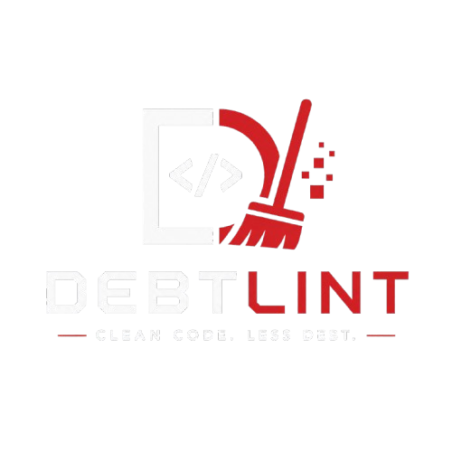

<p align="center">
  
</p>

# Debtlint

**Debtlint** is a technical debt detection tool focused on duplicated logic, built for the era of AI code generation.
It identifies repeated or near-duplicate code segments across a codebase and reports them for refactoring.

## Vision

As coding assistants become mainstream, "silent" duplication appears quickly:
- existing utility functions get rewritten,
- business patterns are repeated,
- logic becomes fragmented across multiple files.

Debtlint provides a **programmatic, fast, and cost-efficient** way to prevent this drift and keep architecture healthy over time.

## Objectives

- Detect exact duplications and structural similarities.
- Surface duplicated blocks with file and line locations.
- Provide actionable reports (terminal + JSON) for local use and CI.
- Integrate easily into team workflows (local, CI, agents).
- Stay as language-agnostic as possible.

## Install

```bash
cargo install debtlint
```

Or from the repository:

```bash
cargo install --path .
```

## Quick start

1. Create a `debtlint.config.json` at the root of the project:

```json
{
  "src": ".",
  "excludes": ["target", "node_modules", ".git"]
}
```

2. Optionally train and save your own vocabulary as `.debtlint-vocab.json`:

```bash
debtlint --save-vocab .debtlint-vocab.json
```

3. Run Debtlint (reuse the vocabulary to skip BPE training):

```bash
debtlint --load-vocab .debtlint-vocab.json
```

Or run without a saved vocabulary (trains BPE on the fly):

```bash
debtlint
```

## How It Works

The Debtlint pipeline follows four main steps:

1. **Code ingestion**
   Read tracked source files under `src` from `debtlint.config.json`, while respecting `excludes`.

2. **BPE encoding**
   Train (or load) a Byte Pair Encoding vocabulary to turn source into token sequences that capture recurring patterns.

3. **Winnowing-based duplicate detection**
   Build hashed shingles over the token stream, select fingerprints with a sliding window, then extend matching regions into duplicated blocks.

4. **Reporting**
   Print a human-readable summary by default, or JSON for CI and agents (`--report-format json`).

## Why BPE

BPE is historically a compression and tokenization technique, notably used to segment large amounts of text efficiently.
In Debtlint, this logic helps highlight repetitive structures and grammatical blocks of code.

Core reference: [Byte pair encoding - Wikipedia](https://en.wikipedia.org/wiki/Byte_pair_encoding)

More detail: [doc/bpe.md](./doc/bpe.md)

## CLI

```bash
debtlint [OPTIONS]
```

| Flag | Default | Description |
|------|---------|-------------|
| `--vocab-size` | `1000` | Max vocabulary size (base + merges) |
| `--min-frequency` | `2` | Min pair frequency to create a merge |
| `--load-vocab <PATH>` | — | Load a vocabulary JSON and skip BPE training |
| `--save-vocab <PATH>` | — | Save the trained vocabulary as JSON |
| `--output-encoded <PATH>` | — | Write encoded token sequences as JSON |
| `--shingle-size` | `50` | Shingle size in tokens (Winnowing) |
| `--window-size` | `3` | Sliding window size in shingles |
| `--min-tokens` | `20` | Minimum duplicated block length in tokens |
| `--report-format` | `text` | `text` or `json` |

Examples:

```bash
# Human-readable report
debtlint

# JSON for CI / agents
debtlint --load-vocab debtlint-vocab.json --report-format json

# Train and persist a vocabulary
debtlint --vocab-size 2000 --save-vocab vocab.json
```

Configuration is read from `debtlint.config.json` in the current directory.

## GitHub Actions Integration

Use the github action in this repository to analyze pull requests:

```yaml
- uses: PoCInnovation/Debtlint/action@main
  with:
    vocab-path: path/to/vocab.json
    extensions: 'rs, py, ts'
```

Debtlint can fail early visibility on technical debt before it lands on `main`.

## Agent integration

Debtlint can sit in an agent loop after code generation:
- generate code,
- run `debtlint --report-format json`,
- refactor reported duplicates,
- re-run until clean (or after a fixed number of iterations).

An agent skill lives in [`skills/debtlint`](./skills/debtlint).

## Contributing

Contributions are welcome.
Read the guide: [CONTRIBUTING.md](./CONTRIBUTING.md)

[Project presentation video](https://www.youtube.com/watch?v=-JjcPTZ7Omg&feature=youtu.be)

## Our PoC team ❤️

Developers
| [<br><sub>Enzo Ruffino</sub>](https://github.com/EnzoRuffino) | [<br><sub>Loan Riyanto</sub>](https://github.com/skl1017) | [<br><sub>Rayan</sub>](https://github.com/Rayan-ouer) |
| :---: | :---: | :---: |

Manager
| [<br><sub>Laurent Gonzalez</sub>](https://github.com/lg-epitech) | [<br><sub>Lohan</sub>](https://github.com/lhnfe) |
| :---: | :---: |

<h2 align=center>
Organization
</h2>

<p align='center'>
    <a href="https://www.linkedin.com/company/pocinnovation/mycompany/">
        
    </a>
    <a href="https://www.instagram.com/pocinnovation/">
        
    </a>
    <a href="https://twitter.com/PoCInnovation">
        
    </a>
    <a href="https://discord.com/invite/Yqq2ADGDS7">
        
    </a>
</p>
<p align=center>
    <a href="https://www.poc-innovation.fr/">
        
    </a>
</p>

> 🚀 Don't hesitate to follow us on our different networks, and put a star 🌟 on `PoC's` repositories

> Made with ❤️ by PoC
